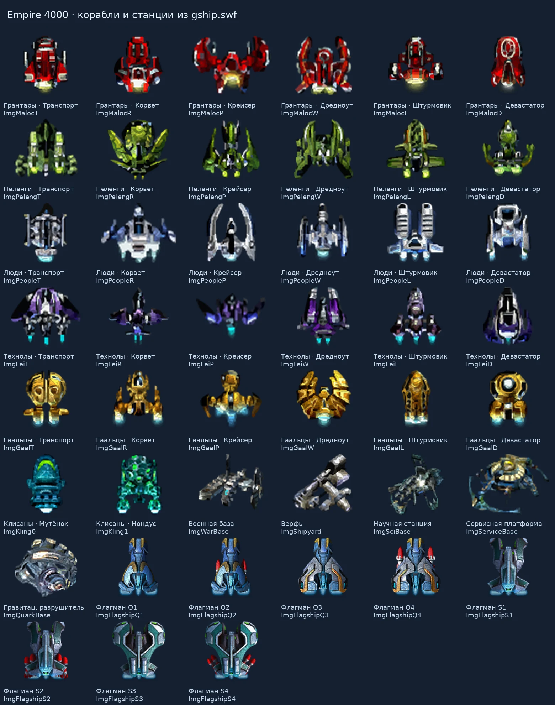
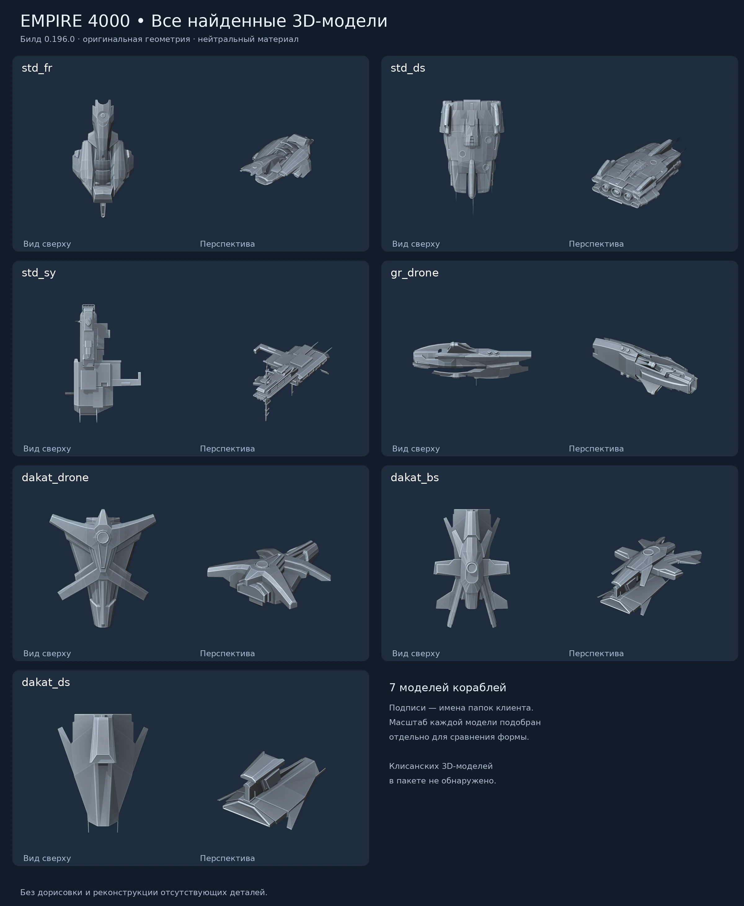
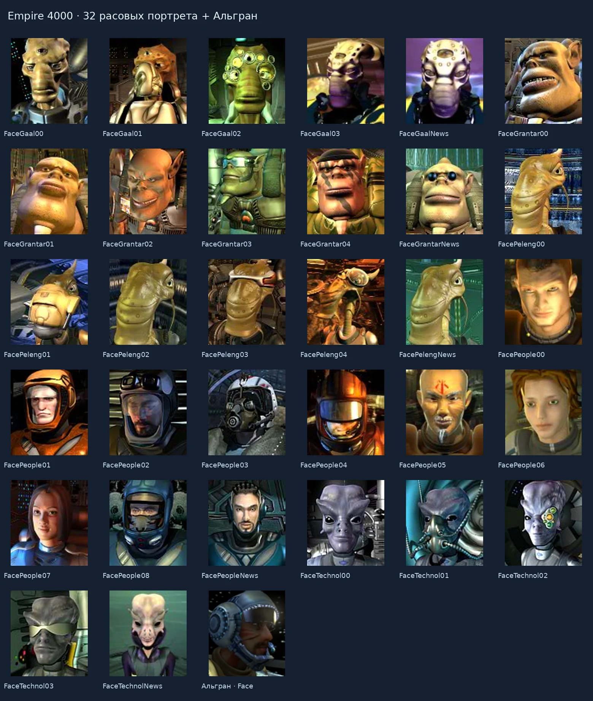
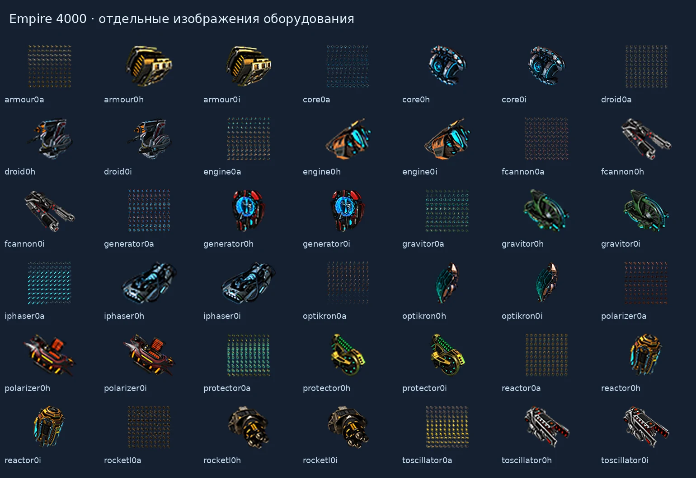

# Empire 4000 — исследовательские заметки по миру, сюжету и клиенту 0.196.0

> Обновлено: 2026-11-10. Отдельный исследовательский свод по незавершённой Empire 4000. Не включать автоматически в канон КР1/КР2/HD, SRQuest, StarTime или собственного проекта.
>
> Метки: **[текст]** — прямо сказано в сценарии; **[персонаж]** — версия собеседника; **[код]** — проверенный участок клиента; **[вывод]** — наша реконструкция; **[неясно]** — не установлено; **[противоречие]** — источники расходятся; **[механика]** — правило игры, не объективная физика мира.

## 1. Источник, охват и воспроизводимость

Исследован публичный установщик `Empire4000_distr_0_196_0.exe`, 97 860 732 байта; SHA-256:

```
572b6956d557e57525c8cd9720adfba6a36d426d12e6cb0824db5221876dedae
```

[Архив установщика](https://web.archive.org/web/20140825090409id_/http://www.elementalgames.com:81/download/empire/Empire4000_distr_0_196_0.exe). Версия AIR-манифеста — **0.196.0**. Установщик распакован как самораспаковывающийся ZIP без запуска; проверена целостность 230 файловых записей. Официальные страницы 2014 — января 2015 указывали эту версию с датой 03.03.2014. Дата сборки не является датой действия сюжета.

### Корпус

- `empire/quest/rus/training.txt` — основное обучение и пиратская история.
- `training2.txt` — стратегический склад и Эфинай.
- `research.txt` — освоение технологий и восстановление промышленности.
- `planetsiege.txt` — дистанционное управление ракетой при осаде.
- `list.txt`, `process.txt` — регистрация и запуск сценариев; зарегистрированы только четыре перечисленных.
- `exmpl_txt_quest.txt` — пример сценария, не пятая подтверждённая глава.
- `empire/news_rus.txt` — **347 процедурных шаблонов новостей**, не хроника 347 состоявшихся событий.
- `empire_air.swf`, `empire/gship.swf`, `gcommon.swf`, `gplanet.swf` — код, изображения и строки интерфейса.
- `empire/ship/*` — семь отдельных 3D-корпусов; `empire/item/*` — 42 PNG оборудования.

Первый проход извлёк 19 586 записей строковых пулов SWF. Второй проход JPEXS Free Flash Decompiler 26.4.0 экспортировал 1241 класса AS и 748 растровых ресурсов. Числа включают библиотеки, интерфейс, повторы и служебные имена — это не число лорных фактов или уникальных иллюстраций. Отдельно экспортирован 101 кадр составных символов gship.swf. Встречаются артефакты декомпиляции вроде `§§pop`; восстановленный AS не тождествен исходникам разработчика.

**Граница проверки:** статический разбор клиента, текстов и ресурсов. Не запускались игра и установщик; нет полного серверного кода, динамических баз предметов и созвездий. Не проверена достижимость каждого диалогового узла на работающем сервере. Отсутствие данных в клиенте не доказывает отсутствие на сервере.

Источники ниже вида `Common.as:2534` относятся к `Empire/Common.as` в декомпиляции основного SWF. Номера строк TXT — в извлечённых оригиналах. `SWF #…` — индекс первичного объединённого массива строк, не ID игрового объекта; при наличии точного AS ключа ориентироваться на него.

## 2. Где и когда происходит действие

- **[текст]** Обучение датировано **4013 годом** (`training:addWhereAmI`, строка 64).
- **[текст]** Действие происходит среди территорий пяти знакомых цивилизаций, в Галактике, где действует Галактический Совет. Конкретное обучение — освобождение захваченного пиратами созвездия. Общая игра содержит множество созвездий правителей и альянсов.
- **[неясно]** Нельзя объявлять это созвездие Седьмым регионом. Прямой связи с Советом Девяти, Гастонской войной и трансморферами в клиентском корпусе не установлено.
- **[неясно]** «Седьмой регион» предположительно относится к концептам StarTime; принадлежность требует независимой проверки. Документы [«Седьмой регион»](../../Лор%20седьмого%20региона/Седьмой%20регион.txt) и [«Фаоны»](../../Фаоны/Сюжет.md) нельзя молча сшивать с билдами Empire 4000.
- **[вывод]** Кризис и территориальная раздробленность не означают исчезновения Совета или изоляции всего места действия.

## 3. Пиратская история: последовательность и афера

1. Герой приходит в себя на повреждённом корабле. Альгран, искусственная личность компьютера, предлагает помочь порабощённому населению. Первоначальная версия — случайный перенос человека из прошлого и надежда на возвращение.
2. Первые реальные противники — дакаты: бой с дроном, сбор трофеев, замена оборудования, добыча кварковых ядер и ремонт. Затем начинается освоение собственного созвездия.
3. Игрок освобождает планеты, получает промышленность и флот. Управление населением перехватывается через ментальные ретрансляторы и «импульс императора».
4. Противники — грантары-анархисты и гаальцы-беспредельщики. Первые располагают войсками, вторые технологиями. Пираты используют подавляющий волю психотронный газ.
5. Освобождённые специалисты помогают в производстве и кибервойне. Противник использует энергетический шантаж и детей-заложников. Требуется лечение жителей после длительного воздействия газа.
6. Усиление игрока создаёт мотив для возобновления союза противников. Альгран подталкивает сорвать его.
7. Фаньвэй, технол из отдела борьбы с пиратством Совета, раскрывает **третью группировку — пеленгов-интеллигентов**, управлявших Альграном. Их не взяли в долю при первоначальном дележе. Имея скромный флот, они использовали чужака для расчистки территории от конкурентов.
8. У пеленгов похищено устройство дублирования живого организма через пространство-время. Герой — копия человека XXI века, оригинал остался жить в прошлом. Устройство вызвало энергетический всплеск, замеченный Советом.
9. Совет направил специальный флот, некоторое время наблюдал за пиратами и повлиял на попытку возобновить союз грантаров с гаальцами, чтобы раскрыть намерения пеленгов.
10. Герою предлагают продолжить жизнь как правителю под покровительством Совета. Предусмотрены помощь жителям, компенсации, переселение и суд над пиратами.

**Суть обмана:** освобождение жителей реально, но советник скрывает заказчика, происхождение героя и то, кому выгодны его победы. Точный план пеленгов относительно героя после победы не раскрыт достаточно, чтобы утверждать его последующее убийство, замену или добровольную передачу власти.

### Происхождение группировок и надёжность рассказа

- **[персонаж]** Грантары-анархисты прежде отдавали 25% пиратского дохода генеральному штабу, затем вышли из подчинения. Не обобщать на политику всех грантаров.
- **[персонаж]** Гаальцы-беспредельщики — искусственно созданный подвид для опасных исследований, включая полёт в чёрную дыру; осознав свою участь, сбежали на боевых кораблях. Это не новая основная раса.
- **[текст, финальное подтверждение]** Фаньвэй говорит, что история первых двух групп и прохождение роя разбитых звёзд правдивы (`training:speakPlease`, примерно 2258–2268). Это повышает надёжность общей истории, но не подтверждает каждую реплику Альграна по отдельности.
- **[неясно]** Фаньвэй не подтверждает, что рой направили дакаты.

## 4. Дакаты и клисаны

### Дакаты

- **[персонаж]** Появились за 10–15 лет до обучения; сначала неагрессивные разведчики, неудачные попытки связи, затем рост числа, помехи и нападения. При дате 4013 интервал около 3998–4003 — расчёт, не прямо указанная хроника.
- **[персонаж]** Технологии сопоставимы с местными; атаки внезапны, постоянной линии фронта нет, разведывательные группы 3–5 кораблей не равны общему числу противников.
- **[неясно]** Машинная природа — гипотеза; древность, создатели и конечная цель в этих текстах не раскрываются.
- **[код]** `qShootDakat`: уничтожить один дрон владельца Dakat. Последующие задачи требуют оборудование и пять кварковых ядер. Дакаты — непосредственная боевая и трофейная часть начального обучения, а не только фон.
- **[код]** У созвездий есть индикатор `m_SpInv`, при котором показывается «Вторжение дакатов» (`Info.as:12918`). Значение поступает с данными созвездия. Полный алгоритм вторжений, периодичность и масштаб не восстановлены.
- **[неясно]** Нет подтверждения, что дакаты руководят пиратами, создали газ либо организовали дублирование героя.

### Клисаны

- **[текст]** Новые налёты состоят из мутят и нондусов; сведений о нынешней Махпелле нет. Возвращение клисан не выбирает автоматически концовку КР1.
- **[текст]** В исследовательской ветке нужны их останки: протоплазма используется для улучшения брони и ремонта баз. Пираты тоже рассчитывают на неё.
- **[подсказки]** Появляются из червоточин при наличии занятых планет; больше занятых планет — больше клисан. Предпочитают крупнейший анклав и планету с большим числом звеньев. Это клиентское объяснение, не восстановленный целиком серверный алгоритм.
- **[текст]** У Тагата есть конкретная червоточина. Игрока учат приманивать клисан скоплением сил и уничтожать военными базами.
- **[противоречие]** `research:whoIsKling` называет их неорганическими, а `ShipDesc[9/10]` и `ItemDesc[14]` — органическими. Первичный SR1_rus.txt около строки 4395 поддерживает небиологическую эволюцию как мнение учёных, но не устраняет разночтение клиента.

## 5. Научные исследования: точная цепочка

**[текст]** Учёный прямо определяет исследования как восстановление технологической основы по матрицам данных и чертежам: устройство известно, но производственный образец и адаптацию к местным условиям надо создать заново (`research:39–40`). Ограничены мощности, а не обязательно фундаментальные знания всей Галактики.

| Стадия | Задача и смысл |
|---|---|
| qFirst | Освоить крейсеры: более прочные корабли для освобождения планет. |
| qTransport1 | Увеличить трюмы транспортов для восстановления инфраструктуры. «Метод Пажитнова» — шутка про эффективную укладку контейнеров, не доказательство пространственного сжатия. |
| qDreadnought1 | Освоить дредноуты, дающие огневую мощь. |
| qDevastator1 | Освоить девастаторы для ракетного обстрела соседних орбит. |
| qWarBase0 | Изучить военные базы и их построение; создать четыре базы на орбите Тагата. |
| qWarBase1 | Уничтожить 300 нондусов у Тагата; изучить ремонт и броню баз второго уровня, используя протоплазму. Число 300 — условие задания, не население клисан. |
| qSciBase1 | Изучить и построить научную станцию у Тагата после землетрясения и цунами, повредивших наземные лаборатории. |
| qShipyard | Освоить верфь и бригаду дроидов, построить верфь у Кароуса, отремонтировать десять кораблей. Для ремонта нужны модули. |
| qLast | Дальнейший выбор технологий передаётся игроку; учёные займутся восстановлением природы пострадавших планет. |

**Другие существенные сведения** (`research:225–396`):

- Протоплазма сохраняет свойства после падения через атмосферу. Для использования в исследованиях её нужно переместить в трюм флота.
- Базы рекомендуют рассредоточивать, чтобы распределять огонь клисан и успевать ремонтироваться.
- Научная станция возле червоточины ускоряет исследования.
- Между станциями создаются порталы для ресурсов и техники. Пираты использовали это для переброски войск в тыл.
- Учёные организовали диверсии: уничтожены пиратская верфь и два транспортных звена, нарушена доставка модулей.
- Предложение исследовать возвращение героя требует принимающего маяка или технологий центрального научного центра. Это ранняя гипотеза; фактическое возвращение копии не показано.

## 6. Ветки и ограничения сценариев

| Файл | Стадий [Quest,…] | Заголовков, включая служебные | Строк вариантов/переходов |
|---|---:|---:|---:|
| training.txt | 36 | 235 | 723 |
| training2.txt | 6 | 35 | 39 |
| research.txt | 9 | 42 | 128 |
| planetsiege.txt | 5 | 155 | 265 |

Всего **56 стадий**. Это не 56 независимых сюжетных квестов. Условные блоки, вызовы GoTo/NextQuest/RunQuest, внешние события и циклические ответы влияют на порядок прохождения.

- **Основная история:** 36 стадий; qEnd содержит дополнительные вопросы об одном исходе. Альтернативной развязки пиратской аферы не обнаружено.
- **Склад:** 6 стадий; случайные цифры, пять регуляторов, счётчик 20 действий, кодовая проверка совпадения. Эфинай хранит секрет как двигательную последовательность; нынешний хранитель погиб при таране. Орбитальный резерв у Антикоры обслуживается автоматикой. Не утверждать, что провал головоломки физически удаляет серверную планету.
- **Осада:** 5 стадий; ракета под дистанционным управлением должна уничтожить генератор. Цель выбирается из девяти участков; есть автоматика, ручной выбор, случайные препятствия, повторный запуск после провала. Успех вызывает `home DestroyGen`. Числа боеголовок и помех — параметры сценария.
- **Исследования:** 9 стадий, описанных выше.

## 7. Расовые способности и названия

Основные цивилизации — грантары (малоки), пеленги, люди, технолы (фэяне), гаальцы. Старые имена сохраняются в новостях и ресурсах. Они не добавляют две новые расы.

**[код]** Соответствия установлены по `FormRaseFeatures…` (`Common.as:2534–2538`) и выбору в `FormRace.as:390–409`:

- **Грантары:** - Структура кораблей на 60% больше. - Девастаторы аннигилируют быстрее и наносят вражеским кораблям дополнительно 100% урона.
- **Пеленги:** - Скорость кораблей на 50% больше, что позволяет покинуть бой, при этом не теряя скорость при уходе с орбиты вражеской планеты. - На передовой ударная сила кораблей увеличивается на 50%. - Крейсеры на передовой с вероятностью 20% взламывают 4 крейсера противника.
- **Люди:** - В бою корабли используют нанитов, которые разбирают структуру вражеских кораблей для ремонта своих собственных. Что увеличивает урон на 30% и ремонтирует собственные корабли со скорость 25% от повреждений вражеских кораблей.
- **Технолы:** - Корабли, при потере 50% структуры, оснащены энергетическим щитом, который блокирует 95% повреждений с 30% коэффициентом рассеивания. - Дредноуты могут менять режим лазера с боевого на трансиверный. Что позволяет восстанавливать щиты у кораблей.
- **Гаальцы:** - Корабли оснащены барьером, который уменьшает урон на 25%, при этом накапливает энергию, позволяющую мгновенно нанести большой урон вражеским кораблям.

Проценты — параметры конкретной версии. Из них не выводится биология вида. Ранее соответствие считалось неподтверждённым; проверка AS сняла эту неопределённость.

## 8. Графика и трёхмерные корпуса

### Изображения стратегического режима

**45 отобранных корабельных/станционных представлений:** 30 кораблей пяти рас (транспорт, корвет, крейсер, дредноут, штурмовик, девастатор), 2 клисана, 5 общих станций, 8 вариантов флагмана. Всего экспортирован 101 кадр символов; остальные нельзя автоматически считать отдельными новыми кораблями.

- `ImgKling0` — мутёнок; `ImgKling1` — нондус (`GraphShip.as:470–486`; `Common.ShipName[9/10]`).
- `ImgMaloc…` используется для грантаров, `ImgFei…` — для технолов; старые имена действующие.
- Гравитационный разрушитель — общая станция `ImgQuarkBase`, а не дакатский эсминец.



### Модели

| ID | Папка | Подтверждённый класс / имя |
|---:|---|---|
| 1 | std_ds | Эсминец «Неустрашимый» |
| 2 | std_fr | Фрегат «Решительный» |
| 3 | gr_drone | Дрон «Защитник» |
| 4 | std_sy | Верфь «Нева» |
| 5 | dakat_drone | Дакатский дрон |
| 6 | dakat_bs | Дакатский линкор |
| 7 | dakat_ds | Дакатский эсминец |

Источники: `Common.InitHull:6147–6533`, `Common.HullName`, `Engine.Space:29–58`.

**Исправление:** dakat_ds использует `dakat_bs/dif1.atf.gz` и `dakat_bs/lum1.atf.gz`. Отсутствие собственных текстур в папке не означает их отсутствие у модели. В обзорном рендере все корпуса намеренно серые.

p1/p2/p3 — части одного корпуса, не самостоятельные корабли. `door.mesh.gz` — отдельная часть верфи; реализованная анимация двери не подтверждена. Класс Carrier, локализованный как «Авенджер», предусмотрен, но ни один из семи корпусов не имеет этого класса; восьмой готовой модели не найдено. Клисанские 3D-модели не обнаружены, их 2D-графика извлечена.



### Портреты

32 расовых изображения: 27 обычных лиц (5 грантарских, 5 пеленгских, 9 человеческих, 4 технольских, 4 гаальских) и 5 дикторов. Альгран — отдельный ресурс `Face`. Фаньвэй — `FaceTechnol03`, Эфинай — `FaceTechnol01`.

`FormDialog.BitmapFace:127–148`: номер -2 у людей выбирает Альграна, -1 — диктора; остальные номера берутся по модулю числа лиц расы. Поэтому FaceNum=123 не означает 124 имеющихся портрета. Одно лицо может обслуживать разные роли; подпись «Особая ракета» с гаальским изображением не доказывает живую гаальскую личность в ракете.



### Предметы и экономика

42 PNG, 14 базовых семейств оборудования: двигатель, реактор, ядро, генератор, гравитор, поляризатор, протектор, оптикрон, дроид, пушка, ракетная установка, фазер, излучатель, броня. Изображения разных вариантов не равны независимым принципам действия.



Локально есть описания ресурсов, 26 названий/описаний зданий и таблица производственных цепочек (`Common.BuildingItemInit:6054–6128`). Но экземпляры предметов, их бонусы и коэффициенты поступают динамически (`UserList.GetItem/QueryItem/AnswerItem:1417–1792`). Полного серверного каталога не восстановлено.

**Проверка червоточины:** `EmpireMap.ProcessActionWormholeAtk:16402–16420` требует груз типа 33 и количество >=10, затем отправляет `emwormhole`. Для этого действия подтверждены **10 кварковых ядер**. Подсказка про **200 000 протоплазмы** расходится с этой проверкой; не считать обе цены одновременным платежом. Другие способы открытия и окончательная серверная проверка не исследованы.

## 9. Реестр дополнительных лорных находок

Ниже — систематизация исходного текстового аудита. Поздние уточнения кода в разделах выше имеют приоритет над ранними предположениями. Утверждения персонажей и процедурные новости сохраняют свои ограничения.

### Хронология

- **Прямо в тексте.** Обучение прямо датировано 4013 годом. Название Empire 4000 не является точной датой каждого эпизода. Источник: `training.txt:64`.
- **Рассказ Альграна.** Дакаты появились 10–15 лет назад; сначала это были неагрессивные разведчики. Контакт установить не удалось. Затем их число выросло, появились помехи навигации и дальней связи и начались нападения. Источник: `training.txt:165–205`. При принятии даты 4013 получается приблизительно 3998–4003; это вычисление, а не отдельная указанная дата.
- **Рассказ персонажа.** Первая война с клисанами отнесена к концу XXX века. Их новое появление — к концу предыдущего столетия относительно обучения. Источник: `research.txt:242–243`. Не назначать точный год второго появления только по этой фразе.
- **Сатирическая новость.** Шаблон новостей ссылается на закон 3978 года о переходе бесхозной территории под контроль альянса. Источник: `news_rus.txt:2598`. Поддерживает тему легализованного передела собственности; описанный захват не является фиксированным событием.

### Расы

- **Согласование названий.** Основные цивилизации: люди, пеленги, гаальцы, грантары и технолы. В новостях сохранились названия малоки и фэяне. Источник: `training.txt; news_rus.txt; строки SWF`. Грантары соответствуют малокам, технолы — фэянам; старые названия не добавляют две расы.
- **Гипотеза персонажа.** Природа дакатов не установлена. Предположение об их машинной природе проговаривается без доказательства. Источник: `training.txt:165–205,600–610`. Не приписывать билду подтверждение древнего искусственного интеллекта из концепта «Фаоны».
- **Предположение.** Альгран подозревает дакатов в опустошении области, названной роем разбитых звёзд. Источник: `training.txt:72`. Это зацепка для расследования, а не доказанное применение оружия уничтожения звёзд.
- **Реплика персонажа.** Предложенная этимология «дакат» связана с недоразвитым существом из ниоткуда. Источник: `training.txt:165–205`. Язык и достоверность этимологии не установлены; не считать самоназванием.
- **Локальная характеристика.** Разведывательные группы дакатов описываются как 3–5 кораблей; для крупных операций их собирается больше. Источник: `training.txt:469–470`. Это не общее число дакатов и не фиксированное число врагов кампании.
- **Рассказ персонажа.** Клисаны находятся в другом рукаве Галактики. Названы крупные нондусы и небольшие мутята; сведений о нынешней Махпелле нет. Источник: `research.txt:242–253`. Возвращение клисан не доказывает конкретную концовку первой игры.
- **Внутреннее противоречие.** Диалог называет клисан неорганическими, подсказки — органическими, а протоплазму — органической материей клисанского происхождения. Источник: `research.txt:242; SWF #14347–14348,#14382`. Сохранить разногласие. Возможны разные редакции текста; научное объяснение не дано.
- **Предметное описание.** Присутствуют ноды — простейшие микроэлементы доминаторов. Источник: `SWF #14366,#14383`. Подтверждает присутствие наследия доминаторов; не доказывает активную войну с ними в этой версии.
- **Рассказ Альграна.** Гаальцы-беспредельщики описаны как искусственно созданный подвид для опасных исследований, включая путешествие в чёрную дыру; они сбежали на боевых кораблях. Источник: `training.txt:1042–1044`. Это подвид и политическая группа, не шестая основная цивилизация. Сильная тема прав созданных существ.

### Сюжет

- **Прямо в тексте.** Альгран — искусственная личность корабельного компьютера, первоначальный проводник игрока. Источник: `training.txt:35`.
- **Раскрытие финала.** Ранняя версия о случайном переносе человека и возможности возвращения подрывается финалом: игрок — копия человека XXI века; оригинал продолжает жить. Источник: `training.txt:42–75,2283–2288`. Ключевой конфликт личной идентичности и права распоряжаться жизнью копии.
- **Прямо в тексте.** Фаньвэй, технол из отдела борьбы с пиратством Галактического Совета, раскрывает устройство аферы. Источник: `training.txt:2244–2288`.
- **Прямо в тексте.** Помимо грантаров-анархистов и гаальцев-беспредельщиков действуют пеленги-интеллигенты. Последние управляют Альграном и используют похищенное устройство пространственно-временного дублирования. Источник: `training.txt:2258–2288`.
- **Объяснение персонажа.** По объяснению финального собеседника, человека выбрали из-за доверия местных к людям и непредсказуемости пришельца из другого времени. Источник: `training.txt:2270`. Не выводить отсюда доказанную способность всех остальных цивилизаций предсказывать будущее.
- **Сюжет обучения.** Создание собственной империи связано со взломом ментальных ретрансляторов и импульсом императора, перехватывающим контроль над населением. Источник: `training.txt:928–950`. Освобождение от одного хозяина оказывается установлением другой зависимости.
- **Рассказ Альграна.** Конкретные грантарские пираты прежде отдавали четверть дохода генеральному штабу и вышли из подчинения из-за выплат. Источник: `training.txt:1034`. Зацепка для государственной поддержки пиратства; не общая характеристика всех грантаров.
- **Сценарные события.** Освобождённые специалисты меняют программирование Альграна и создают вирус, искажающий пиратские радары. Противник отвечает отключением сети. Источник: `training.txt:1170,1347,1380–1417`. Кибервойна с адаптацией защиты, ограниченность общей сети.
- **Прямо в тексте.** На Цайдахх пираты перегружают термоядерные электростанции, вынуждая игрока ускорить нападение. Источник: `training.txt:1684–1687`.
- **Сценарные события.** На Регистае заложниками становятся дети из центров отдыха. В одной операции используются крейсеры-приманки с искусственным управлением. Источник: `training.txt:1756,1853`. Не смешивать беспилотные приманки с поздней добровольческой операцией живых экипажей.
- **Прямо в тексте.** Саногама — бывшая база флота и место военно-инженерных университетов, превращённое в пиратскую цитадель. Источник: `training.txt:1889`.
- **Сценарные события.** Долгое воздействие подавляющего волю газа оставляет устойчивые последствия. На Кристане создают сеть лечебниц и перевозят пострадавших порталами. Позднее остаётся чуть больше сотни ещё не вылеченных. Источник: `training.txt:1908–1938,1987`. Это не число погибших. Восстановление общества становится отдельной задачей после военной победы.
- **Сценарные события.** Усиление игрока меняет баланс: грантары предлагают гаальцам треть созвездия. Альгран добивается срыва их объединения. Источник: `training.txt:2005–2050`. Союзы возникают из выгоды и страха, а не закреплены расовой принадлежностью.
- **Сценарные события.** У Вельды находится орбитальная установка «гравитационный разрушитель», связанная с производством газа. Лангар используется для отсечения подкреплений. Источник: `training.txt:2160 и финальные блоки`. Установка не тождественна корабельной модели dakat_ds только из-за слова «разрушитель».
- **Прямо в тексте.** В финальной операции участвуют добровольческие экипажи; пиратские флоты возвращаются после нападения на соседнее созвездие. Источник: `training.txt:финал`.

### Политика

- **Объяснение финала.** Совет замечает энергетический всплеск устройства, направляет силы и ведёт расследование, вмешиваясь в отношения пиратов. Источник: `training.txt:2258–2288`. Совет существует и способен действовать; экономический коллапс не равнозначен исчезновению всех институтов.
- **Прямо в тексте.** Предусмотрены восстановление экологии, компенсации и переселение. Суд учитывает применение химического оружия и сотрудничество с расследованием. Наиболее опасным преступникам предназначен Глюок без амнистии. Источник: `training.txt:финал`.
- **Исход обучения.** Игрок получает положение самостоятельного правителя под юрисдикцией Совета. Источник: `training.txt:2283–2288`. Независимость и надгосударственный контроль сосуществуют.
- **Процедурные и часто сатирические шаблоны.** Возможные новости изображают субсидии производителям, территориальные протектораты, местное подданство, право альянсов менять законодательство и споры о внешнем управлении. Источник: `news_rus.txt:1055,2240,2598 и другие`. Подходит для модели раздробленного общества; отдельные карикатурные решения Совета не считать буквальной конституцией.
- **Возможная новость.** Есть сюжетный шаблон акционирования разорённого созвездия и его рейдерского захвата через пакет ценных бумаг. Источник: `news_rus.txt:2493`. Пригодная завязка экономической кампании без внешнего космического вторжения.
- **Возможная новость.** После бомбардировки захватчику может грозить обвинение в военном преступлении, включая применение запрещённых боеприпасов. Источник: `news_rus.txt:2707`. Межзвёздное право сохраняется, хотя его применение непоследовательно.

### Общество

- **Детали окружения в шаблонах.** Упоминаются галактическая почта, ДНК-подписи грузов, межзвёздные ярмарки, медицинская помощь Совета, вакцины, правозащитные организации, корреспонденты и публичные заявления. Источник: `news_rus.txt:379,906 и другие`. Гражданский мир богаче исключительно военной стратегии.
- **Спорная гипотеза внутри сатиры.** Археологическая находка в Зондуре объявлена возможным следом предков гаальцев, но сам текст высмеивает вывод профессора. Источник: `news_rus.txt:97`. Не доказывает происхождение гаальцев из Зондура.
- **Ненадёжный источник обобщений.** Расовые шутки произносятся дикторами с предвзятостью и встроены в торговые и военные шаблоны. Источник: `news_rus.txt:473 и другие`. Не превращать шутки об интеллекте, медицине и алкоголе в обязательную биологию расы.

### Персонажи

- **Именованные роли.** Бошанх, Таурин и Антакрим — местные инженеры и программисты. Кристан связан с создателем Альграна. Эфинай — технол, бывший хранитель стратегического резерва. Источник: `training.txt:1347,1418; training2.txt:79`. Имена дают небольшую сеть гражданских действующих лиц, а не только командиров.

### Побочная история

- **Прямо в тексте.** На Атриме газ помешал хранителю уничтожить секрет. Его пытали через системы жизнеобеспечения. Последовательность открытия хранилища сохранилась как двигательный навык, а не осознаваемое знание. Источник: `training2.txt`.
- **Сюжет и правила головоломки.** Следующий хранитель погиб, таранив флагман. Автоматизированный резерв скрыт на теневых орбитах Антикоры. Робоохрана использует пять регуляторов, суточный код, ограничение действий и угрозу самоуничтожения. Источник: `training2.txt`. Пять регуляторов — устройство конкретного склада, не стандарт всей цивилизации.
- **Описание локальной инфраструктуры.** На резервной базе роботы собирают и обслуживают флагманы. Ремонтные дроиды постепенно расходуют собственные детали. Источник: `training2.txt`. Хорошая история о забытом объекте, пережившем персонал.

### Наука

- **Прямое объяснение.** Исследования игрока преимущественно восстанавливают производственные процессы по имеющимся матрицам данных и чертежам. Источник: `research.txt:39–40`. Прогресс в механике — во многом восстановление утраченного доступа к технологиям.
- **Раннее объяснение.** Для предполагаемого обратного переноса требуется принимающий маяк либо технологии центрального научного центра. Источник: `research.txt:70–71`. Читать с учётом финального раскрытия: реальное возвращение копии не показано.
- **Тексты исследований.** Клисаны реагируют на большие скопления кораблей. Научные станции используют соседство с червоточинами и портальную логистику; наземная лаборатория уязвима для землетрясений и цунами. Источник: `research.txt:253,317–329`. Появляются причины распределённой обороны и переноса науки на орбиту.
- **Гипотеза, не измеренный предел.** Кварковые ядра связываются с длительным хранением энергии; предположение о тысячелетнем сохранении заряда обсуждают как научную гипотезу. Источник: `research.txt; training.txt:627`. Не объявлять вечным источником энергии.

### Технологии

- **Конкретная авария.** Компьютер ограничивает повреждённые и лишние системы ради экономии, включая жизнеобеспечение; гипердвигатель повреждён. Радиосигнал помощи может идти годы. Источник: `training.txt:129–154,724–803`. Разные средства связи и транспорта имеют разные ограничения; нет доказанного универсального мгновенного радио.
- **Игровые объяснения.** Присутствуют экспресс-модификаторы выбора расы и аномалия, дублирующая корабль. Источник: `training.txt:958; SWF #14378`. Не доказывает массового превращения населения в другой биологический вид.
- **Описания игровых возможностей.** Есть стабилизатор червоточины, гравитационная ловушка и оружие чёрной дыры. Источник: `SWF #15339,#15482–15483`. Время действия и исключения для классов кораблей — баланс; смысловую идею можно использовать отдельно.
- **Механика MMO.** Планетарный щит описан через сильное замедление боя и временные ограничения. Источник: `SWF #15460`. Не переносить множитель замедления в объективную физику без независимого сюжетного подтверждения.

### Экономика

- **Прямо в тексте.** Водородные платформы у газовых гигантов, склады, фермы, электроника, металлургия и сборочные комплексы формируют промышленную цепочку. Подготовка инженеров и механизация снижают брак. Источник: `training.txt:1146,1955; SWF #14385–14432`.
- **Названия и описания.** Ресурсы и процессы: ксеноновые скважины, титан из ильменита, кремний из кварцита, антикристаллы из кристаллических разломов, антипроотоны, кварковые ядра, топливо. Источник: `SWF #14385–14432`. Это словарь экономики; полных физических параметров и научного обоснования нет.
- **Названия и описания.** Есть климатическая станция для изменения планетных условий, университет инженеров, академии механиков и навигаторов. Источник: `SWF #14385–14432`. Подготовка кадров и восстановление среды — самостоятельные отрасли.

### Бой

- **Механика боя.** Маршевый и боевой режимы; внешние боевые позиции и внутренние позиции транспорта и платформ. Крейсер может блокировать соседние позиции, опустошитель поражать соседние орбиты. Источник: `training.txt:965–974; SWF #14339–14352`. Удобно для тактики, но схема слотов не является универсальным устройством реальных орбит.
- **Прямо в тексте.** Для осады цитадели дистанционно управляемая специальная ракета флагмана уничтожает электростанцию, поддерживающую защиту, пока транспортный десант отвлекает оборону. Источник: `planetsiege.txt:56–89`.
- **Ветвящийся эпизод.** Ракета проходит слои атмосферы, сталкиваясь с противоракетной обороной, перехватчиками, помехами, неисправностями и заграждениями. На финале выбирается участок цели. Источник: `planetsiege.txt:155 и последующие ветки`. Разные препятствия требуют разных средств. РЭБ не устраняет обычные пули и физические заграждения.
- **Константы сценария.** Десять боеголовок, три защитных залпа, четыре применения помех и сетка целей — параметры этого задания. Источник: `planetsiege.txt`. Не использовать как универсальные ТТХ всех имперских ракет.

### Граница знания

- **Прямо в тексте.** Зарегистрированы четыре сценария: training, training2, research, planetsiege. Файл exmpl_txt_quest — пример, а не ещё одна подтверждённая глава кампании. Источник: `quest/rus/list.txt; process.txt`.
- **Административные и MMO-функции.** Скрытие созвездия при выходе, его перенос к флоту, удаление и генерация относятся к управлению игровым миром. Источник: `SWF #16323–16328`. Не утверждать физическое перемещение целых звёздных скоплений.
- **Кодовые обозначения.** Внутренние имена классов и восемь слотов ИИ не являются перечнем восьми цивилизаций. Источник: `SWF: идентификаторы RaceKling, OwnerAI0…7`. RaceKling не добавляет отдельную расу к клисанам.
- **Ограничение извлечения.** Нельзя определить постоянное число союзников и врагов: владельцы, альянсы, территории и часть событий подставляются динамически. Источник: `Весь доступный локальный пакет`. Числа 3 пиратские группы и 5 основных цивилизаций не заменяют число участников конкретной серверной партии.

## 10. Новости: события, общество и ограничения

347 записей — процедурные шаблоны с владельцами, альянсами, товарами и территорией в подстановках. Условия и предвзятость диктора обязательны для интерпретации. Их нельзя превращать в единую датированную историю.

| Тип | Шаблонов |
|---|---:|
| Export | 61 |
| Import | 50 |
| Manufacture | 17 |
| DestroyFlagship | 22 |
| DestroyQuarkBase | 21 |
| CombatStart | 25 |
| CombatEnd | 26 |
| CotlPrepare | 22 |
| CotlReady | 22 |
| CotlCapture | 17 |
| CotlCtrl | 12 |
| HomeworldCapture | 17 |
| Invasion | 17 |
| Battle | 18 |

Полезные мотивы: приватизация и акционирование созвездий, рейдерские захваты, протектораты, субсидии, местное подданство, публичная медицина, галактическая почта с ДНК-подписью, правозащита и обвинения в военных преступлениях. Шутки об интеллекте рас не фиксировать как биологические законы. Археологическая гипотеза о гаальских предках в Зондуре прямо подаётся сомнительной.

## 11. Внешняя сверка и отдельные концепты

- [Первичный текст КР1](source/SR1_rus.txt): рассмотрены представления о небиологической природе Махпеллы и варианты финала. Возвращение клисан в Empire не выбирает автоматически мирную или боевую концовку.
- [Материалы сообщества о сервере «Созвездие»](https://empire4k.fandom.com/ru/wiki/Категория:Сервер_Созвездие): вторичная сверка даты 4013 по Хооту, переименования рас, тюремного характера Глюока. Внешние подробности истории созвездий не выдаются за содержимое билда.
- [Официальный сайт, архив января 2015](https://web.archive.org/web/20150131043752/http://www.elementalgames.com/): сведения о версии клиента.
- [Фаоны](../../Фаоны/Сюжет.md): древний ИИ дакатов, Ахт, иной источник энергии и план нового Большого взрыва не раскрыты найденным клиентским текстом. Это отдельный концепт неизвестного отношения к данной редакции. Отсутствие в клиенте само по себе его не опровергает.
- [Седьмой регион](../../Лор%20седьмого%20региона/Седьмой%20регион.txt): принадлежность к StarTime остаётся рабочей гипотезой. С Советом и созвездием обучения Empire не отождествлять.

## 12. Что остаётся неизвестным

1. Происхождение и конечная цель дакатов; кто вызвал рой разбитых звёзд.
2. Серверная логика вторжений, точные параметры выбора целей, полный состав динамических партий.
3. Судьба нынешней Махпеллы и причины возвращения клисан.
4. Полная база серверных предметов и описаний созвездий.
5. Достижимость каждого узла при реальном состоянии сервера; наличие альтернативных кампаний на сервере.
6. Реальная степень использования каждого ресурса: динамически построенные имена исключают простой вывод «нет буквальной ссылки — вырезано».
7. Точная история редакций и связь Empire/StarTime/«Фаонов»/Седьмого региона.

**Не выводить:** число восьми рас из OwnerAI0…7, неизменное число союзников из числа слотов, буквальное перемещение звёзд из функции перемещения созвездия, универсальные физические законы из MMO-баланса.

## 13. Возможное применение в собственном проекте — только идеи

Это наши предложения, не факты Empire: освобождение как прикрытие чужой борьбы за власть; права человеческой копии; восстановление общества после психохимического порабощения; права искусственного подвида; забытый автономный резерв; экономическая война за территорию; исследование неизвестного противника через противоречивые свидетельства. Если используются, адаптацию отмечать отдельно от источника.

## 14. Дополнительные материалы

- [Проверяемые данные аудита](empire4000/audit_evidence.json): классы корпусов, пути текстур, расовые описания, стадии и переходы сценариев, счётчики экспорта.
- [Предыдущие заметки по SRQuest](SRQUEST_RESEARCH_NOTES.md) — отдельная игра и отдельный корпус; не смешивать события.

### Исправления ранних выводов обсуждения

- «У дакатского эсминца нет текстур» → использует общие текстуры линкора.
- «Расы способностей пока не сопоставлены» → сопоставлены по именованным ключам и ветвям FormRace.
- «Дакаты лишь фон обучения» → реальные начальные противники и источник трофеев; поздняя пиратская афера не доказана как их операция.
- «Происхождение первых пиратских групп только со слов Альграна» → общая история подтверждается Фаньвэем в финале; частные подробности требуют осторожности.
- «Открытие червоточины стоит 200 000 протоплазмы» → проверенное клиентское действие требует десять кварковых ядер; старая строка сохранена.
